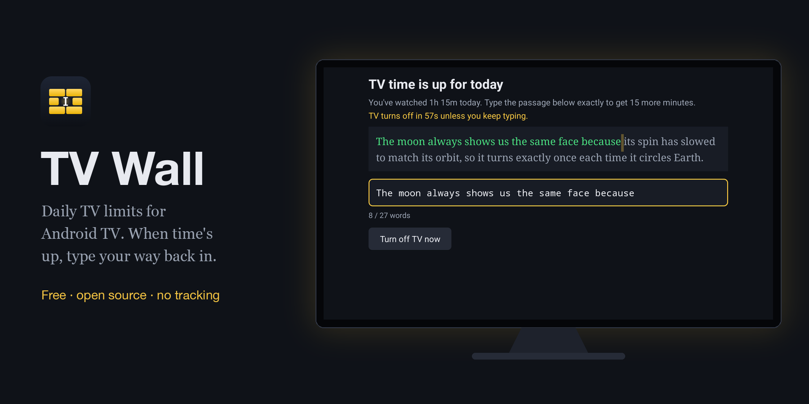
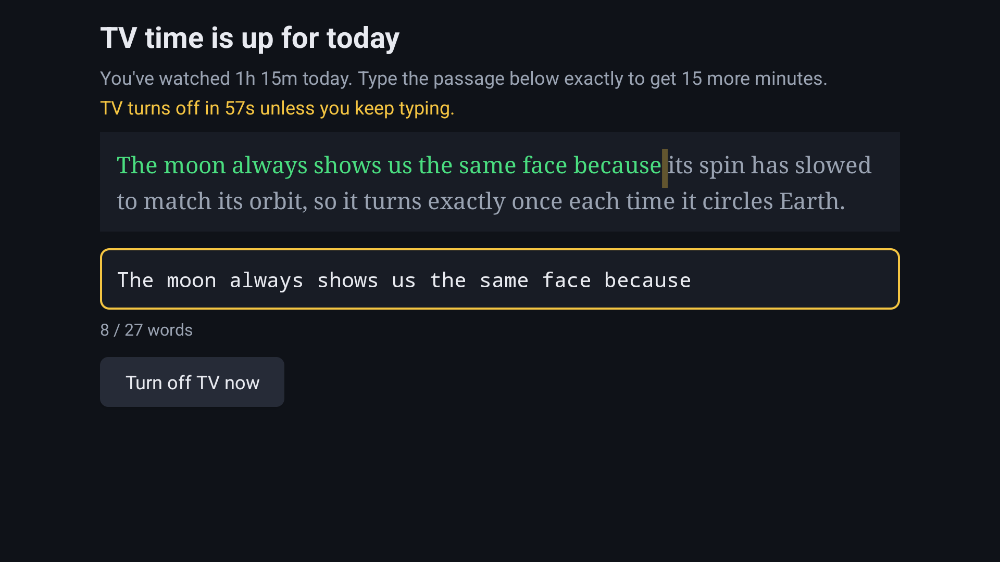
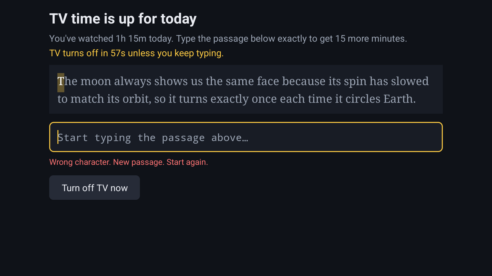
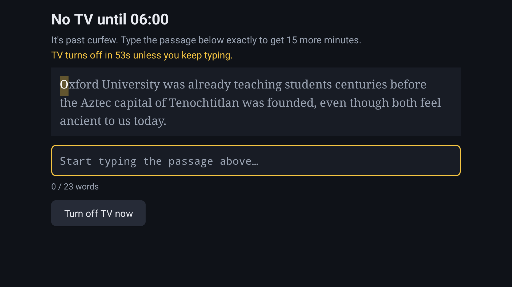
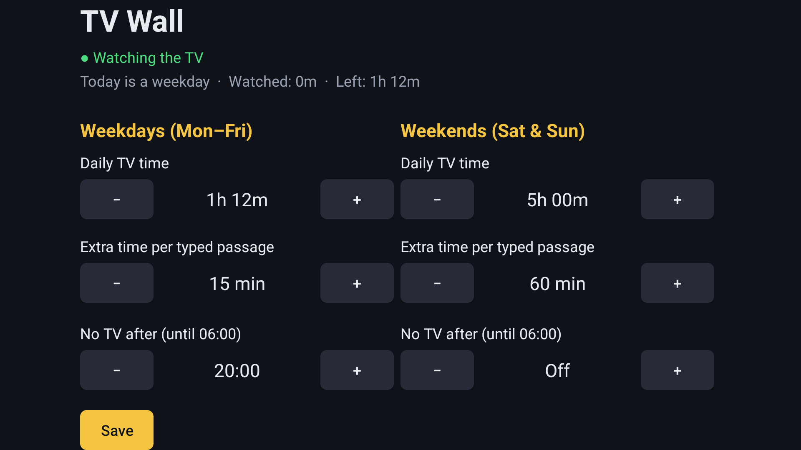
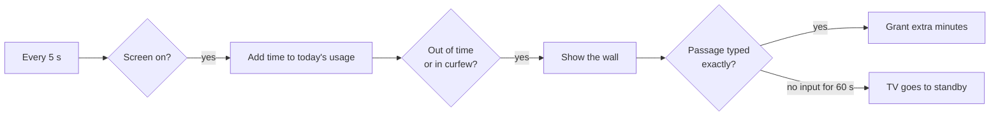

<p align="center">
  
</p>

<h1 align="center">TV Wall</h1>

<p align="center">
  Daily screen-time limits for Android TV and Google TV.<br>
  When your time is up, the only way to keep watching is to type a short passage, perfectly.
</p>

<p align="center">
  <a href="https://github.com/iBala/tvwall/releases/latest">Download</a> ·
  <a href="#install">Install</a> ·
  <a href="#how-it-works">How it works</a> ·
  <a href="PRIVACY.md">Privacy</a>
</p>

---

TV Wall runs on the TV itself. It counts how long the screen is on each day. When the day's allowance runs out, or curfew starts, a wall covers whatever is playing. To get past it you retype a passage of about 25 words exactly. One typo and you start again with a new passage. If nobody types anything for 60 seconds, the TV switches itself off.

Each passage teaches something: a surprising fact, a mental model, or a useful life skill. So even when you do earn more time, you learn something first. TV Wall is the TV version of [Typewall](https://github.com/iBala/typewall), a Chrome extension that does the same for distracting websites, and it uses Typewall's 100 passages.

## Screenshots

| Time is up | One mistake and you start over |
|---|---|
|  |  |
| **Curfew** | **Settings** |
|  |  |

## Features

- **Separate rules for weekdays and weekends.** Each has a daily allowance, extra time per typed passage, and an optional curfew.
- **Counts screen-on time only.** Standby doesn't count. The count resets at midnight.
- **Curfew.** "No TV after 20:00" blocks the TV from 20:00 until 06:00 the next morning. A Friday curfew covers early Saturday too.
- **A wall you can't click past.** Pressing Home, Back or opening another app brings the wall back within a second.
- **Switches the TV off.** After 60 seconds with no typing, the TV goes to standby. The wall is still there when you turn it back on.
- **Typing earns extra time.** Type the passage exactly to get more time: 5, 10, 15, 30 or 60 minutes, set separately for weekdays and weekends.
- **No shortcuts.** A wrong character, a backspace, a paste or an autocorrect clears the input and swaps in a new passage. Suggestions are turned off.
- **Warnings.** A message appears 5 minutes and 1 minute before time runs out.
- **Loosening is locked.** Making a rule stricter saves instantly. Giving yourself more time, longer unlocks or a later curfew means typing a passage first.
- **Private.** No internet permission, no accounts, no analytics. See [PRIVACY.md](PRIVACY.md).

The default rules are 1h 12m a day with 15-minute unlocks and no TV after 20:00 on weekdays, and 5 hours a day with 60-minute unlocks and no curfew on weekends. Lowering them saves at once. Raising them needs one typed passage, like any other loosening.

## Install

TV Wall isn't on the Play Store. You install the APK yourself, then switch on its accessibility service. It needs Android TV 9 or later. It has been tested on a Sony BRAVIA 3 (Google TV, Android TV 12).

### 1. Install the app

**On the TV, with the Downloader app** (no computer needed):

1. Install **Downloader** by AFTVnews from the Play Store on your TV.
2. Allow Downloader to install apps. On Google TV, open **Settings → Apps → Security & restrictions → Unknown sources** and turn on Downloader. The menu path varies by TV maker.
3. Open Downloader and enter this address:

   ```
   https://github.com/iBala/tvwall/releases/latest/download/tvwall.apk
   ```

4. Select **Install** when Android asks.

**Or from a computer, with adb.** First turn on debugging on the TV. Go to **Settings → System → About** and select **Android TV OS build** 7 times. That turns on Developer options. Then turn on **Settings → System → Developer options → USB debugging**. Then run:

```sh
adb connect <tv-ip-address>:5555      # accept the prompt on the TV
adb install tvwall.apk
```

### 2. Switch on the service

Open **TV Wall** from your Apps row. Select **Open Accessibility settings**, choose **TV Wall**, and turn it on. Back in TV Wall, the status line should say **● Watching the TV**.

If the switch is greyed out ("Restricted setting", seen on some Android 13+ TVs), turn it on over adb instead:

```sh
adb shell settings put secure enabled_accessibility_services com.ibala.tvwall/.WatchService
adb shell settings put secure accessibility_enabled 1
```

### 3. Set your rules

Pick the daily time, the extra time each passage earns, and the curfew for weekdays and weekends, then press **Save**.

**Tip:** typing with a remote is slow. The Google TV app on your phone has a keyboard that types straight into the TV.

## How it works



- TV Wall runs as an Android **accessibility service**. The system starts it at boot and keeps it running. That lets it open the wall from the background and put the TV in standby with `GLOBAL_ACTION_LOCK_SCREEN`, with no root and no maker-specific API. It doesn't read what other apps show: `canRetrieveWindowContent` is off.
- Every 5 seconds it adds the time since the last check to today's usage, but only while `PowerManager.isInteractive` says the screen is on. A long gap between checks means the TV was in standby, so that time doesn't count.
- Once you're out of time or in curfew, it checks every second, and whenever the front window changes, that the wall is still in front.
- An unlock pushes today's budget to *time used so far + unlock minutes*. During curfew, it allows TV until *now + unlock minutes*.

```
app/src/main/java/com/ibala/tvwall/
  WatchService.kt      accessibility service: counts time, enforces, switches the TV off
  BlockActivity.kt     the wall: passage challenge and 60 s idle standby
  Challenge.kt         the typing challenge, ported from Typewall's challenge.js
  SettingsActivity.kt  weekday and weekend rules; loosening needs a passage
  Store.kt             rules, curfew windows and daily usage in SharedPreferences
app/src/main/assets/passages.txt   the 100 passages
```

## Build from source

You need JDK 17 and the Android SDK (Android Studio includes both).

```sh
./gradlew assembleDebug      # app/build/outputs/apk/debug/app-debug.apk
./gradlew assembleRelease    # app/build/outputs/apk/release/app-release.apk
```

Release builds are signed with the key described in a properties file at `~/.config/tvwall/keystore.properties`, or at the path in `TVWALL_KEYSTORE_PROPERTIES`:

```properties
storeFile=/path/to/release.jks
storePassword=...
keyAlias=...
keyPassword=...
```

Without that file, release builds are signed with your local debug key, which is fine for installing on your own TV.

Debug builds include a receiver for testing the wall without waiting. Release builds leave it out.

```sh
adb shell am broadcast -n com.ibala.tvwall/.DebugReceiver --el used_ms 7200000      # set today's usage
adb shell am broadcast -n com.ibala.tvwall/.DebugReceiver --ei curfew_weekday 1230  # curfew at 20:30
```

## Honest limitations

TV Wall adds friction. It is not a lock.

- Anyone with the remote can turn the service off in Accessibility settings or uninstall the app.
- Pulling the plug or switching to another HDMI input can get around it, depending on how your TV handles inputs.
- With USB debugging on, anyone on your network can control the TV over adb. Turn it off after installing.

It works best as a pause between the urge to keep watching and actually doing it.

## Contributing

Issues and pull requests are welcome. Test changes on a real TV or an Android TV emulator before opening a PR. To suggest a passage, open it in [Typewall](https://github.com/iBala/typewall), which this app shares its passages with.

## License

[MIT](LICENSE)
